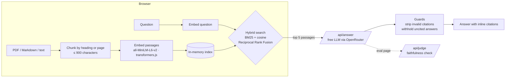

# Docs Q&A — retrieval-augmented generation with citations

**Live demo:** https://rag-docs-qa.vercel.app

Ask questions about a set of documents and get short answers where every fact carries a citation to the passage it came from. If the documents don't contain the answer, it says so instead of guessing. It ships with a fictional dental clinic's handbook, and you can upload your own PDF, Markdown or text files.

## Architecture



## How it works

1. **Chunking.** Markdown is split at headings and PDFs at pages, then packed into passages of up to ~900 characters at paragraph and sentence boundaries. A passage never mixes two topics, which keeps retrieval precise and citations meaningful.
2. **Embeddings.** Every passage becomes a 384-dimensional vector from `all-MiniLM-L6-v2` (q8), run in the browser with transformers.js. The sample handbook is embedded ahead of time by `scripts/build-corpus.mjs` with the same model and settings, so questions and passages live in the same vector space.
3. **Hybrid retrieval.** Each question gets two rankings: BM25 keyword scores (good for exact terms like "OPG", branch names, prices) and cosine similarity (good for paraphrases like "fee" vs "costs"). They are merged with Reciprocal Rank Fusion (k = 60) and the top 5 passages are kept. The UI shows all three scores for every passage.
4. **Answering.** Only those 5 passages go to the model, numbered `[1]`–`[5]`, with strict rules: cite every fact, use no outside knowledge, and reply "I can't find that in the documents." when the answer isn't there. Free models are tried in order and rotated on rate limits, errors or timeouts (`lib/openrouter.js` refuses any model id that isn't `:free`).
5. **Guards.** After the model replies, citations to passages it wasn't given are stripped, and an answer with no valid citation is withheld and replaced with the refusal. So an unsupported answer can't reach the user even if the model ignores its instructions.
6. **Evaluation.** The Eval tab runs 10 hand-written questions (8 answerable, 2 not) and reports retrieval hit@5, whether the answer cited the right passage, whether it refused correctly, and faithfulness as judged by a second model call (`/api/judge`).

## Run locally

```bash
npm install
npm run build:corpus                    # re-embed corpus/*.md into public/corpus/index.json
export OPENROUTER_API_KEY=...           # a free OpenRouter key is enough
npm run dev                             # http://localhost:3000
npm test                                # smoke test: retrieval hit-rate + one answerable and one unanswerable question
```

## Limits

- The index lives in browser memory: uploads disappear on reload, and very large document sets would need a real vector store (pgvector, for example).
- `all-MiniLM-L6-v2` is small and English-first. A bigger or multilingual embedding model would retrieve better on long or non-English documents.
- PDFs need a text layer; scanned PDFs would need OCR first.
- Free models can be slow or rate-limited at busy times. The client rotates models, but an answer can occasionally take 10–20 seconds.
- The eval set is small and hand-written. It catches regressions but is not a benchmark.
- The sample clinic, its prices and policies are fictional.
